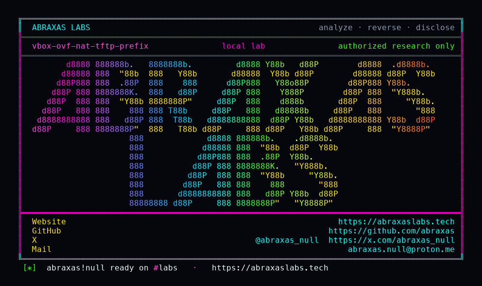

<p align="center">
  
</p>

<p align="center">
  <a href="https://abraxaslabs.tech"><strong>abraxaslabs.tech</strong></a>
  &nbsp;·&nbsp;
  <a href="https://github.com/abraxas">github.com/abraxas</a>
  &nbsp;·&nbsp;
  <a href="https://x.com/abraxas_null">@abraxas_null</a>
  &nbsp;·&nbsp;
  <a href="mailto:abraxas.null@proton.me">abraxas.null@proton.me</a>
  &nbsp;·&nbsp;
  <a href="https://github.com/abraxas/vbox-ovf-nat-tftp-prefix">vbox-ovf-nat-tftp-prefix</a>
</p>

# vbox-ovf-nat-tftp-prefix

**Class:** File read
**Reach:** Local (guest) after UI:R import

**Oracle VM VirtualBox OSS** `7.2.20` (`f2792cf44`) - Oracle

vbox:Machine OVF import sanitizes ExtraData, shared folders, NVRAM path, and serial RawFile. It never touches NAT `enable-tftp` or TFTP `@prefix`. libslirp disables TFTP only when `tftp_prefix` is NULL. `DrvNAT` `g_strdup("")` stays non-NULL. Guest RRQ `etc/passwd` with prefix `/` or empty becomes `/etc/passwd`. `../` in the guest name is still rejected.

**Imported NAT TFTP with an empty or `/` prefix lets the guest RRQ host files as the VBox UID.** Not a write. Not host-kernel. Not a leftover of the closed `../` check.

| | |
|---|---|
| ID | no CVE yet |
| Class | **File read** (guest TFTP RRQ of host paths) |
| Reach | **Local (guest)** after **UI:R** import of a vbox:Machine OVF, then VM start |
| CWE | [CWE-22](https://cwe.mitre.org/data/definitions/22.html) leftover of [CVE-2022-21394](https://nvd.nist.gov/vuln/detail/CVE-2022-21394) prefix class |
| CVSS | **High: 7.7** `CVSS:3.1/AV:L/AC:L/PR:N/UI:R/S:C/C:H/I:N/A:N` |
| Product | [Oracle VM VirtualBox OSS](https://github.com/VirtualBox/virtualbox) |
| Affected | **7.2.20** (`f2792cf44f663989818507e36d3db5f978523c5e`) |
| Auth | none in the guest; host user must Import then Start |
| License | [GNU Affero GPL v3.0](LICENSE) |
| Lab | source harness; loopback compose; VirtualBox is not booted |

## What an attacker can do

Ship a vbox:Machine OVF/OVA whose NAT blob has `enable-tftp` and TFTP prefix `/` or empty, plus a guest disk that issues TFTP RRQ to the NAT gateway (`10.0.2.2:69`). The host user imports (File / Import or `VBoxManage import`) and starts the VM. Import clears ExtraData, shared folders, serial RawFile, and NVRAM path. TFTP fields survive. On start, `ConsoleImplConfigCommon` inserts `EnableTFTP`. Empty prefix is omitted from CFGM; `DrvNAT` then defaults `TFTPPrefix` to `""` and `g_strdup`s it. libslirp treats that as enabled.

That is the full privilege set. Nothing here is a host write, a VM-process heap primitive, or a kernel escape.

### Recon (guest TFTP RRQ)

| Method | Sink | Privilege |
|---|---|---|
| TFTP RRQ of `oracle/VBOX-OVF-NAT-TFTP-PREFIX-WITNESS` with imported prefix `""` | libslirp `tftp_handle_rrq` then `RTFileOpen` of prefix + `/` + guest name | **Lab-proven.** Empty prefix stays non-NULL. Built path is `/oracle/VBOX-OVF-NAT-TFTP-PREFIX-WITNESS`. Read-only open returned the witness bytes. |
| TFTP RRQ of the same name with imported prefix `/` | same | **Lab-proven.** Built path is `//oracle/...`, POSIX-same as `/oracle/...`. Witness bytes returned. |
| Path-only analog of guest RRQ `etc/passwd` with empty prefix | `"" + "/" + "etc/passwd"` | **Lab-proven path build.** Result is `/etc/passwd`. The lab does not open host `/etc`. |
| TFTP RRQ of any relative name the VBox UID can open (home keys, `VirtualBox.xml`, host `/etc`, Windows current-drive root) | same `RTFileOpen` | **Inferred.** Same concatenation. Files the process cannot open stay closed (`File not found`). |

### Integrity and availability

| Method | Privilege |
|---|---|
| TFTP WRQ | **Closed.** This TFTP server is RRQ-only. No write handler. |
| Host file overwrite / create | **Closed.** Read-only `RTFILE_O_READ`. |
| VM-process heap, VBoxSVC, other VMs, host kernel | **Closed.** This leftover is a file open of a built path. |
| TFTP DoS | Out of bar. |

### What this leftover does not grant

- Default new VMs: Main writes `fEnableTFTP` false (`Settings.cpp` NATEngine ctor).
- NAT Network: `VBoxNetSlirpNAT` always sets `tftp_path` to `<VirtualBox home>/TFTP` when home exists. RRQs stay under that prefix.
- Generic OVF without a vbox:Machine blob does not copy this NAT TFTP pair.
- Guest filename `../` and a trailing `/` still get "Access violation". That is the closed CVE-2022-21394 walk.
- Intended PXE under a non-empty prefix stays confined (`/work/tftp/boot.pxe` in the lab).
- NULL prefix disables TFTP. No open.
- Shared folders, ExtraData, serial RawFile, and NVRAM dest are still sanitized on this import path.
- No 3D, no Guest Additions, no VRDP, not PUEL.

A real host that imports this appliance and starts the VM gives the guest a read of any path the VBox UID can open. The lab is a source harness of that walk. VirtualBox is not booted.

## How I found it

I pinned [VirtualBox/virtualbox](https://github.com/VirtualBox/virtualbox) **v7.2.20** (`f2792cf44`). NAT plus OVF hunts. 7.2 switched NAT to bundled libslirp 4.9.3. Shared-folder honouring from `.ova` is already treated as a hazard and stripped. TFTP was not on that list.

`Settings.cpp` still reads NAT `enable-tftp` and `TFTP/@prefix` on vbox:Machine import:

```cpp
elmMode.getAttributeValue("enable-tftp", nic.nat.fEnableTFTP);
// ...
pelmTFTP->getAttributeValue("prefix", nic.nat.strTFTPPrefix);
```

`ApplianceImplImport.cpp:6147` sanitizes everything they remembered:

```cpp
config.sanitizeImportedSerialPorts();
config.sanitizeSharedFolderSettings();
config.sanitizeImportedNvramSettings();
if (!m->optListImport.contains(ImportOptions_KeepExtraData))
    config.sanitizeImportedExtraData();
```

Those four bodies never name `strTFTPPrefix` or `fEnableTFTP`.

On start, `ConsoleImplConfigCommon.cpp:2286-2292` inserts `TFTPPrefix` only when non-empty and always inserts `EnableTFTP`. `DrvNAT.cpp:1656-1665` defaults EnableTFTP true for old VMs that omit the key, then:

```cpp
rc = pDrvIns->pHlpR3->pfnCFGMQueryStringAllocDef(pCfg, "TFTPPrefix", &pszTmp, "");
slirpCfg.tftp_path = pszTmp;
```

`slirp.c:698` is `g_strdup`. Empty stays non-NULL. `tftp.c:353-357` only disables on NULL. `364-370` prepends prefix, `/`, guest name. `398-407` rejects `../`. Then `RTFileOpen` of the built path.

Wrong turns already recorded: treating guest `../` as the leftover (CVE-2022-21394, still rejected); treating default new VMs as affected; treating NAT Network home/TFTP as this leftover; claiming WRQ writes; claiming host-kernel. Theatre: opening host `/etc/passwd`. The oracle is a witness file under `/oracle`.

## Lab

```bash
python3 vbox-ovf-nat-tftp-prefix-Abraxas-Labs.py
```

or

```bash
cd lab
./run.sh
```

Source harness of the pin sanitizers, DrvNAT empty-string default, `g_strdup`, and libslirp `tftp_handle_rrq`. Docker compose project `vbox-ovf-nat-tftp-prefix`. Loopback only. VirtualBox is not booted. Witness `VBOX-OVF-NAT-TFTP-PREFIX-WITNESS` is planted at `/oracle/...`. Control PXE file is `/work/tftp/boot.pxe`. Last line:

```
SUCCESS vbox-ovf-nat-tftp-prefix sanitize-miss=yes null-disable=yes empty-prefix-read=yes slash-prefix-read=yes dotdot-reject=yes VBOX-OVF-NAT-TFTP-PREFIX-WITNESS
```

## The fix

Sanitize `nat.fEnableTFTP` and `nat.strTFTPPrefix` on vbox:Machine import the same way ExtraData and shared folders are cleared. Fail closed unless the prefix is a confined directory. Treat empty string as NULL so libslirp disables TFTP. Do not `g_strdup("")` into `tftp_prefix`.

## References

- [github.com/VirtualBox/virtualbox](https://github.com/VirtualBox/virtualbox) tag [v7.2.20](https://github.com/VirtualBox/virtualbox/releases/tag/v7.2.20) (`f2792cf44f663989818507e36d3db5f978523c5e`)
- [`Settings.cpp`](https://github.com/VirtualBox/virtualbox/blob/f2792cf44f663989818507e36d3db5f978523c5e/src/VBox/Main/xml/Settings.cpp) NAT TFTP read (`4873`, `4888-4894`) and import sanitizers (`9654-9682`)
- [`ApplianceImplImport.cpp`](https://github.com/VirtualBox/virtualbox/blob/f2792cf44f663989818507e36d3db5f978523c5e/src/VBox/Main/src-server/ApplianceImplImport.cpp) `i_importVBoxMachine` (`6147-6151`)
- [`ConsoleImplConfigCommon.cpp`](https://github.com/VirtualBox/virtualbox/blob/f2792cf44f663989818507e36d3db5f978523c5e/src/VBox/Main/src-client/ConsoleImplConfigCommon.cpp) (`2286-2292`)
- [`DrvNAT.cpp`](https://github.com/VirtualBox/virtualbox/blob/f2792cf44f663989818507e36d3db5f978523c5e/src/VBox/Devices/Network/DrvNAT.cpp) (`1656-1665`)
- [`slirp.c`](https://github.com/VirtualBox/virtualbox/blob/f2792cf44f663989818507e36d3db5f978523c5e/src/libs/libslirp-4.9.3/src/slirp.c) `g_strdup` (`698`)
- [`tftp.c`](https://github.com/VirtualBox/virtualbox/blob/f2792cf44f663989818507e36d3db5f978523c5e/src/libs/libslirp-4.9.3/src/tftp.c) (`353-407`)
- [CVE-2022-21394](https://nvd.nist.gov/vuln/detail/CVE-2022-21394) closed `../` in the guest TFTP name; this leftover is the OVF-planted prefix

## Contact

Abraxas Labs - [abraxaslabs.tech](https://abraxaslabs.tech) - [github.com/abraxas](https://github.com/abraxas) - [@abraxas_null](https://x.com/abraxas_null) - [abraxas.null@proton.me](mailto:abraxas.null@proton.me)
